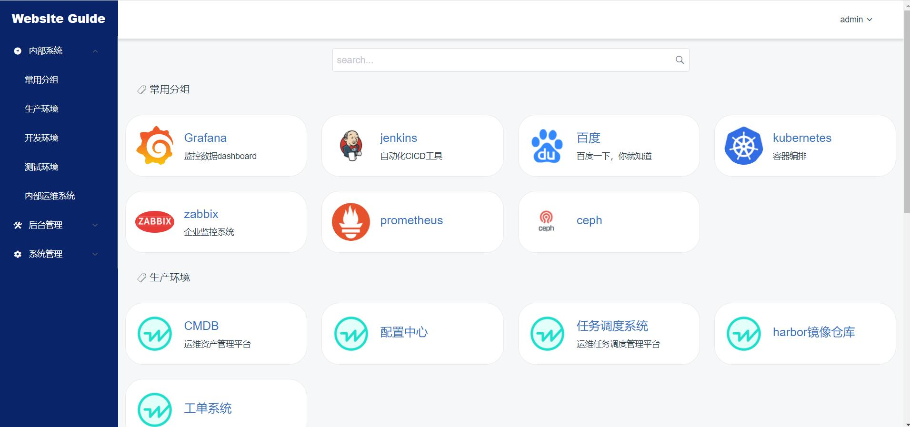
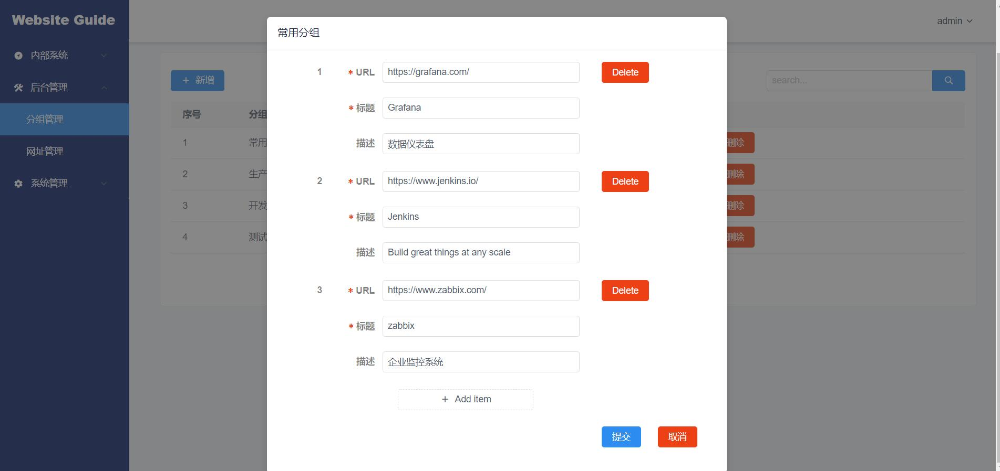
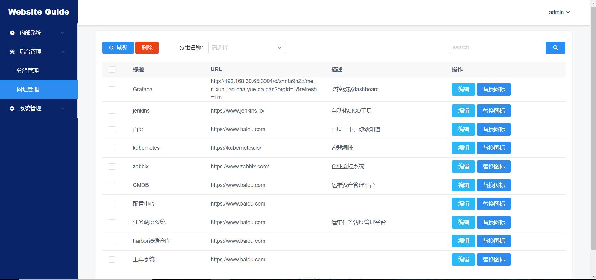
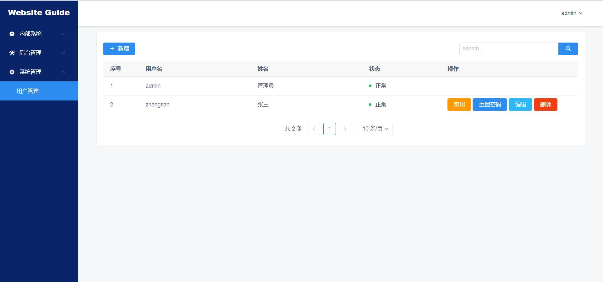

<h1 align="center">WebsiteGuide</h1>

<div align="center">WebsiteGuide网址导航系统主要用于企业记录和管理内部系统地址，具有网址增删改查、icon图标替换等功能，后续考虑增加rbac和其他功能，欢迎使用和交流~</div>


### 环境

- Python 3.6+
- Django 2.2.13
- Djangorestframework 3.12.2
- Node 12.20.1+
- Vue 2.0

### 网址导航



### 支持批量添加



### 网址管理



### 用户管理



### 演示地址

导航页 http://demo.mizhexiao.top:8098/

管理后台 http://demo.mizhexiao.top:8098/admin

username：admin

password：admin

### 快速开始
#### 方法一：dockerhub拉取镜像

```sh
docker pull mizhexiaoxiao/websiteguide:latest 
docker run -d --restart=always --name=websiteguide -p 8098:80 mizhexiaoxiao/websiteguide
```

#### 方法二：dockerfile构建镜像
##### docker安装(版本17.05+)

```sh
yum install -y docker-ce
systemctl start docker
```

##### 构建镜像

```sh
git clone https://github.com/mizhexiaoxiao/WebDockerfile.git
cd WebsiteGuide/websiteapp/tools/Docker
docker build --no-cache . -t websiteguide
```

##### 启动容器

```sh
docker run -d --restart=always --name=websiteguide -p 8098:80 websiteguide
```

##### 访问

浏览器打开http://localhost:8098

管理后台http://localhost:8098/admin

username：admin

password：admin

##### 数据备份与恢复

备份

/usr/bin/docker cp 63dd67259f9d:/WebsiteGuide/db.sqlite3 /opt/deploy/bak/db.sqlite3

/usr/bin/docker cp 63dd67259f9d:/WebsiteGuide/websiteapp/media opt/deploy/bak/icon

恢复

/usr/bin/docker cp /opt/deploy/bak/db.sqlite3 63dd67259f9d:/WebsiteGuide/db.sqlite3

/usr/bin/docker cp /opt/deploy/bak/icon 63dd67259f9d:/WebsiteGuide/websiteapp/media

/usr/bin/docker restart 63dd67259f9d

### 有任何问题请提issue

## 模块说明
- 后端
  - 配置与入口：[settings.py](file:///Users/m684621/Downloads/AAA/ITGang/WebsiteGuide/WebsiteGuide/settings.py)、[urls.py](file:///Users/m684621/Downloads/AAA/ITGang/WebsiteGuide/WebsiteGuide/urls.py)、[wsgi.py](file:///Users/m684621/Downloads/AAA/ITGang/WebsiteGuide/WebsiteGuide/wsgi.py)
  - 模型：[models.py](file:///Users/m684621/Downloads/AAA/ITGang/WebsiteGuide/websiteapp/models.py)（UserInfo、WebSiteGroup、WebSite）
  - 序列化：[websites_serializer.py](file:///Users/m684621/Downloads/AAA/ITGang/WebsiteGuide/websiteapp/serializers/websites_serializer.py)、[group_serializer.py](file:///Users/m684621/Downloads/AAA/ITGang/WebsiteGuide/websiteapp/serializers/group_serializer.py)、[user_serializer.py](file:///Users/m684621/Downloads/AAA/ITGang/WebsiteGuide/websiteapp/serializers/user_serializer.py)、[icon_serializer.py](file:///Users/m684621/Downloads/AAA/ITGang/WebsiteGuide/websiteapp/serializers/icon_serializer.py)
  - 视图与接口：[views.py](file:///Users/m684621/Downloads/AAA/ITGang/WebsiteGuide/websiteapp/views.py)、路由注册：[websiteapp/urls.py](file:///Users/m684621/Downloads/AAA/ITGang/WebsiteGuide/websiteapp/urls.py)
  - 管理命令：[updatedb.py](file:///Users/m684621/Downloads/AAA/ITGang/WebsiteGuide/websiteapp/management/commands/updatedb.py)、[useradd.py](file:///Users/m684621/Downloads/AAA/ITGang/WebsiteGuide/websiteapp/management/commands/useradd.py)
  - 静态与媒体：STATIC 指向前端构建产物，[settings.py](file:///Users/m684621/Downloads/AAA/ITGang/WebsiteGuide/WebsiteGuide/settings.py#L85-L89)；媒体目录为 websiteapp/media
- 前端
  - 入口与拦截器：[main.js](file:///Users/m684621/Downloads/AAA/ITGang/WebsiteGuide/websitefronted/src/main.js)，自动注入 Authorization: JWT <token>
  - 路由与守卫：[router/index.js](file:///Users/m684621/Downloads/AAA/ITGang/WebsiteGuide/websitefronted/src/router/index.js)
  - 状态管理（localStorage 存储 token）：[store/index.js](file:///Users/m684621/Downloads/AAA/ITGang/WebsiteGuide/websitefronted/src/store/index.js)
  - 主要页面与组件：components 目录（导航首页、分组管理、网址管理、用户管理）

## API 使用
- 基础说明
  - 基础前缀：/api/
  - 鉴权方式：登录获取 JWT 后，所有需要鉴权的接口在请求头加入 Authorization: JWT <token>
  - 路由注册见：[websiteapp/urls.py](file:///Users/m684621/Downloads/AAA/ITGang/WebsiteGuide/websiteapp/urls.py)
- 登录
  - POST /api/login/，Body: { "username": "admin", "password": "admin@1234" }，返回 { token }
- 分组管理
  - GET/POST /api/group/、GET/PATCH/DELETE /api/group/{id}/
- 网址管理
  - GET/POST /api/website/、GET/PATCH/DELETE /api/website/{id}/
  - 批量删除：DELETE /api/website/delete/?selectId=1,2,3
- 网站数据聚合
  - GET /api/alldata/（按分组嵌套返回）
  - GET /api/alldata/{id}（指定分组）
- 用户管理
  - GET/POST /api/user/、GET/PATCH/DELETE /api/user/{id}/
  - 修改密码：POST /api/user/{id}/change-passwd/，Body: { "password1": "...", "password2": "..." }
- 图标读写
  - GET /api/icon/?id={website_id}（返回图片内容）
  - POST /api/icon/（form-data，字段：id, name, file；name 不能为 default.png）

## 示例请求
```bash
# 登录获取 token
curl -s http://localhost:8098/api/login/ \
  -H 'Content-Type: application/json' \
  -d '{"username":"admin","password":"admin@1234"}'

# 创建分组
curl -s http://localhost:8098/api/group/ \
  -H "Authorization: JWT <token>" \
  -H 'Content-Type: application/json' \
  -d '{"name":"默认分组","description":"示例"}'

# 批量创建网址
curl -s http://localhost:8098/api/website/ \
  -H "Authorization: JWT <token>" \
  -H 'Content-Type: application/json' \
  -d '[{"title":"Google","path":"https://google.com","description":"搜索"},{"title":"Bing","path":"https://bing.com"}]'

# 批量删除
curl -s -X DELETE "http://localhost:8098/api/website/delete/?selectId=1,2,3" \
  -H "Authorization: JWT <token>"

# 修改密码
curl -s -X POST http://localhost:8098/api/user/1/change-passwd/ \
  -H "Authorization: JWT <token>" \
  -H 'Content-Type: application/json' \
  -d '{"password1":"newpass","password2":"newpass"}'

# 图标替换
curl -s -X POST http://localhost:8098/api/icon/ \
  -H "Authorization: JWT <token>" \
  -F "id=1" -F "name=google.png" -F "file=@/path/to/google.png"
```


本地验证

- 已在本机通过 PyMySQL 成功执行建表与迁移，并创建管理员：
  - 迁移：DB_ENGINE=mysql DB_HOST=127.0.0.1 DB_PORT=3307 DB_USER=root DB_PASSWORD=123456 DB_NAME=websiteguide python manage.py makemigrations websiteapp && python manage.py migrate
  - 创建管理员：python manage.py useradd -u admin -p admin@1234 -s -n 管理员
相关文件

- MySQL 容器与端口映射：端口 3307→3306、root/123456、初始化库 websiteguide， docker-compose.yml
- 后端数据库配置支持环境变量与 MySQL 默认： settings.py
- 兼容包依赖（使用 PyMySQL）： requirements.txt 、 pyproject.toml

模块概览

- 后端
  - 配置与入口：settings.py、urls.py、wsgi.py
  - 模型与序列化：models.py、serializers 下各文件
  - 视图与路由：views.py、websiteapp/urls.py
  - 管理命令：updatedb.py、useradd.py
- 前端
  - 入口与拦截器：main.js
  - 路由与守卫：router/index.js
  - 状态管理：store/index.js
API 入口

- 基础前缀：/api/
- 鉴权：Authorization: JWT
- 主要 URL
  - 登录：POST /api/login/
  - 分组：/api/group/、/api/group/{id}/
  - 网址：/api/website/、/api/website/{id}/、批量删除 /api/website/delete/?selectId=1,2,3
  - 聚合：/api/alldata/、/api/alldata/{id}
  - 用户：/api/user/、/api/user/{id}/、改密 /api/user/{id}/change-passwd/
  - 图标：GET/POST /api/icon/

curl -X POST http://localhost:8098/api/login/ \
     -H "Content-Type: application/json" \
     -d '{"username": "admin", "password": "admin"}'


curl -H "Authorization: JWT <token>" \
     http://localhost:8098/api/user/


docker run -it --rm -v "$PWD":/WebsiteGuide -w /WebsiteGuide node:14.18-alpine sh